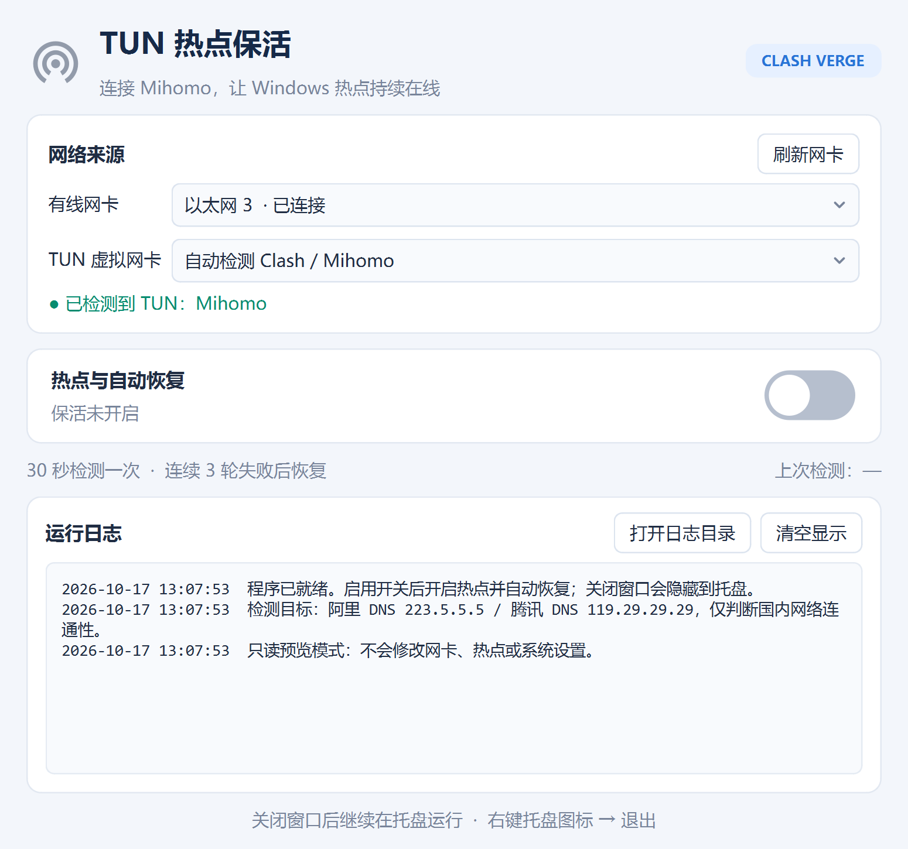

# AutoTunHotspot · TUN 热点保活

适用于 Windows 的桌面工具，将 **Clash Verge / Mihomo TUN** 作为 Windows 移动热点的共享来源，并在断网或热点关闭后自动尝试恢复。

使用 **C++17 + Qt 5.15 + C++/WinRT** 实现，支持系统托盘、实时日志和高 DPI 显示。



## 功能

- **网卡识别**：默认选择已连接且有网关的物理有线网卡，支持手动切换并记忆选择。
- **TUN 检测**：自动查找 Clash / Mihomo，也可手动选择其他名称的 TUN 配置。
- **热点控制**：以 TUN 为共享上游开启 Windows 移动热点，沿用系统中的热点名称和密码。
- **自动恢复**：每轮检查后等待 30 秒继续监控，连续 3 轮国内连通性检测失败后恢复网卡与热点。
- **托盘运行**：窗口 × 隐藏到托盘；双击图标或右键“显示”恢复；右键“退出”结束程序。
- **状态图标**：热点开启且国内网络正常时为蓝绿彩色，其余状态为灰色。
- **运行日志**：显示带时间的日志，并在磁盘自动轮转，适合长期运行。
- **高 DPI 支持**：按系统实际缩放比例渲染，支持 125%、150%、200%、250% 等缩放。

共享链路：

```text
物理有线网络 → Clash / Mihomo TUN → Windows 移动热点 → 手机 / 平板
```

## 运行要求

- Windows 10 2004 或更新版本，或 Windows 11；当前提供 MSVC x64 构建配置。
- 可用的物理有线网卡，以及支持 Windows 移动热点的无线网卡。
- 已运行 Clash Verge / Mihomo，并开启虚拟网卡（TUN）模式。
- 管理员权限：程序正常启动时通过 UAC 请求，用于控制热点和重启网卡。

## 使用方法

1. 在 Windows“设置 → 网络和 Internet → 移动热点”中配置名称、密码和频段。
2. 在 Clash Verge 中开启虚拟网卡模式。
3. 运行 `AutoTunHotspot.exe`，允许管理员权限请求。
4. 确认有线网卡和 TUN 选择正确，打开“热点与自动恢复”开关。
5. 手机或平板连接 Windows 热点，查看实际状态与运行日志。

蓝色开关表示已启用管理与监控；是否成功开启热点、网络是否正常，以旁边的状态文字和托盘图标为准。程序启动后默认不启用管理。

关闭窗口后继续后台运行。关闭开关或右键托盘“退出”，会停止监控并关闭本次管理的热点。退出时可能需要等待当前的 Windows 网络操作完成。

## 自动检测与恢复

| 检测结果 | 程序行为 |
| --- | --- |
| TUN 未开启或暂时消失 | 等待 TUN 出现，不因此反复重启有线网卡 |
| 国内网络正常，热点已关闭 | 以 TUN 为共享来源重新开启热点 |
| 连续 3 轮国内网络检测失败 | 关闭热点、重启所选有线网卡、等待网络与 TUN 恢复，再开启热点 |
| 国内网络正常，但 Windows 返回“共享上游连接受限” | 冷却后恢复网卡和热点 |
| 热点开启且国内网络正常 | 保持运行，继续检查 |

ICMP 检测 `223.5.5.5`（阿里 DNS）和 `119.29.29.29`（腾讯 DNS），任一响应即判定该轮国内网络可用。失败后间隔 2 秒复核，连续 3 轮均失败才判定断网。**不检查代理节点或境外网站可用性。**

恢复操作串行执行，失败后按 60 / 120 / 240 / 300 秒退避重试，期间继续监测，避免频繁重启网卡。程序会尝试关闭“无设备连接时自动关闭热点”的超时机制，停止管理时还原本次更改的设置。

## 从源码编译

### 开发环境

- Visual Studio 2026，安装“使用 C++ 的桌面开发”和 Windows 10 / 11 SDK。
- 支持 `Visual Studio 18 2026` 生成器的 CMake。
- vcpkg，依赖为 `qt5-base:x64-windows` 和 `qt5-svg:x64-windows`。

工程使用 C++/WinRT 和 Windows 网络 API，不提供 MinGW 或 Linux 构建。其他 Visual Studio 版本请直接在 `CMakePresets.json` 中调整生成器。

### 安装依赖

当前预设使用 `D:/Library/vcpkg`，在 PowerShell 中安装依赖：

```powershell
& 'D:\Library\vcpkg\vcpkg.exe' install qt5-base:x64-windows qt5-svg:x64-windows
```

项目使用 vcpkg classic mode，预设中的工具链固定为 `D:/Library/vcpkg/scripts/buildsystems/vcpkg.cmake`，无需设置环境变量。其他机器请直接在 `CMakePresets.json` 中修改该路径。

### 配置、编译与测试

在工程根目录运行：

```powershell
cmake --preset windows-msvc
cmake --build --preset Release-windows-msvc
ctest --preset Release-windows-msvc
```

Debug 版本：

```powershell
cmake --build --preset Debug-windows-msvc
ctest --preset Debug-windows-msvc
```

构建输出：

```text
bin/windows-x64/Release/AutoTunHotspot.exe
bin/windows-x64/Debug/AutoTunHotspot.exe
```

EXE、运行时 DLL、Qt 插件和 `qt.conf` 放在对应配置目录中。CMake 中间文件与静态库留在 `build/`。输出按 `TARGET_PLATFORM` 与 `$<CONFIG>` 区分平台及配置，`TARGET_PLATFORM` 默认为 `windows-x64`。

测试覆盖断网三轮确认、短暂失败、停止取消、恢复操作选择、重试退避，以及窗口隐藏与唤醒、日志上限和图标切换。实际断网恢复、手机联网及长期运行效果需在目标机器上验证。

### 打包分发

```powershell
cmake --install build/windows-msvc --config Release
```

完整运行目录位于 `install/windows_x64/`，包含 EXE、依赖 DLL、Qt 插件、MSVC 运行库和第三方许可证。分发时保留整个目录结构，不能只复制 EXE。发布到 GitHub 时，可将该目录打包上传到 Releases，无需提交二进制产物到源码仓库。

更新正在运行的版本前，先从系统托盘选择“退出”，释放被占用的 EXE。

## 日志与只读诊断

运行数据位于 EXE 同目录：

```text
data/
├── settings.ini           # 网卡选择等本机配置
├── hotspot.log            # 当前日志
└── hotspot.previous.log   # 上一份轮转日志
```

界面最多保留 1000 条日志；当前磁盘日志超过约 2 MB 后轮转，保留一份历史记录。日志和本机配置均不提交到 Git。

以下命令不提权、不启动热点、不重启网卡：

```powershell
& .\bin\windows-x64\Release\AutoTunHotspot.exe --diagnose "$PWD\build\diagnostics.json"
& .\bin\windows-x64\Release\AutoTunHotspot.exe --preview "$PWD\build\preview.png"
```

- `--diagnose`：读取物理网卡、TUN 与热点状态，输出 JSON。
- `--preview`：渲染禁用启动开关的界面，保存截图及同名 `.json` DPI 信息后退出。

## 项目结构

```text
AutoTunHotspot/
├── assets/                         # 图标、Qt/Windows 资源与资源许可
├── docs/images/                    # README 截图
├── src/
│   ├── main.cpp                    # 启动、提权、单实例与只读诊断
│   ├── mainwindow.*                # 主窗口、托盘、日志
│   ├── monitor.*                   # 后台检测与自动恢复
│   ├── network.*                   # 网卡、ICMP、热点与网卡重启
│   ├── policy.h                    # 失败确认和重试策略
│   ├── icons.*                     # 图标渲染与着色
│   └── toggleswitch.*              # 自定义蓝灰开关
├── tests/                          # 恢复策略测试
├── tools/                          # 编译时 ICO 生成工具
├── CMakeLists.txt
├── CMakePresets.json
└── qt.conf
```

## Git 与首次上传

源码仓库忽略 `build/`、`bin/`、`install/`、运行数据、日志、编译中间文件和本机 IDE 设置。源码、`CMakePresets.json`、原始图标、文档和截图正常提交。

先在 GitHub 创建空仓库，再将下面的示例地址替换为自己的仓库地址：

```powershell
git status --short
git add .
git diff --cached --stat
git commit -m "Initial commit"
git remote add origin https://github.com/YOUR_USERNAME/AutoTunHotspot.git
git push -u origin main
```

本地尚未初始化 Git 时，先执行 `git init -b main`。提交前可用 `git check-ignore -v build/ bin/ install/` 核对忽略规则。

## 已知限制

- 网卡重启会让电脑和热点客户端短暂断网，自动恢复不等于全程无中断。
- 检测目标均不响应 ICMP 时会按断网处理；禁止 ICMP 的网络需要调整检测方式。
- 主机联网且热点开启，不能证明手机侧的 DHCP、DNS 或无线链路全部正常。
- TUN 由 Clash Verge / Mihomo 管理，本程序不会替你启动 Clash 或启用它的 TUN 模式。
- 电脑睡眠期间不监控；程序不安装 Windows 服务或开机启动项。

## 第三方资源与许可

热点图标来自 [Google Material Design Icons / wifi_tethering](https://github.com/google/material-design-icons/blob/master/src/device/wifi_tethering/materialicons/24px.svg)，使用 Apache 2.0 许可证。原始 SVG 未改动，程序渲染时按状态着色；来源与许可证见 [assets/NOTICE.md](assets/NOTICE.md) 和 [assets/LICENSE-material-icons.txt](assets/LICENSE-material-icons.txt)。

Qt 使用动态链接，Qt 和其他运行依赖的许可文件会复制到安装目录的 `licenses/`。本项目源码尚未单独指定开源许可证。
